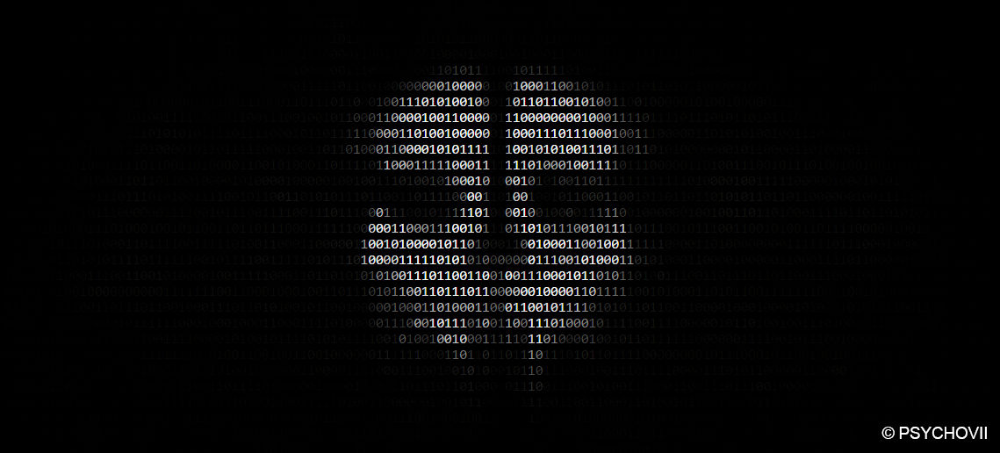

# SaniGhost

<p align="center">
  
</p>

<p align="center">
  <strong>Native POSIX High-Performance File, Database & Storage Sanitizer</strong><br>
  <em>Eliminates OS Metadata, Filesystem Journals, and Solid-State Flash Artifacts.</em>
</p>

<p align="center">
  <sub>Artwork: <em>Binary ASCII CoD Ghost Art</em> by <a href="https://www.deviantart.com/psychovii/art/Binary-ASCII-CoD-Ghost-Art-671458969">PSYCHOVII</a></sub>
</p>

---

## Overview

**SaniGhost** is a lightweight, zero-dependency native C anti-forensic data destruction engine. Unlike conventional utilities that merely invoke standard `unlink()` or single-pass overwrites, SaniGhost implements a deep **5-Stage Chain of Custody Pipeline** that intercepts data at the storage controller, directory tables, filesystem journals, and SQLite application databases.

```text
[ Target Payload ]
        │
        ├──► 1. POSIX Synchronous Multi-Pass Overwrite (O_SYNC / fdatasync)
        │       └─ 0x00 -> 0xFF -> /dev/urandom
        │
        ├──► 2. Hardware Controller Flush
        │       └─ Forces disk controller write buffers to commit to physical media
        │
        ├──► 3. Metadata / Inode Scrubbing
        │       └─ Cryptographically renames file to 32-char hex hash before deletion
        │          (Overwrites directory table entries / dentries)
        │
        ├──► 4. Timestamp & Attribute Zeroing
        │       └─ utimensat() zeroes atime/mtime to {0,0} epoch; ftruncate() zeroes file length
        │
        ├──► 5. Journal Synchronization
        │       └─ unlink() + fsync() on PARENT directory descriptor (O_DIRECTORY)
        │          (Forces ext4/XFS journals to flush deletion transaction immediately)
        │
        └──► 6. Solid-State FTL Discard (Hardware TRIM)
                └─ ioctl(FITRIM) instructs SSD Flash Translation Layer (FTL) to deallocate NAND blocks
```

---

## Features

- **Deep Forensic Elimination:** Destroys file contents, directory entry tables (dentries), access/modification timestamps, and filesystem journals.
- **Cluster Slack Space Zeroing:** Automatically rounds overwrite boundaries to the physical filesystem cluster/block size (`st.st_blksize`), destroying leftover file slack fragments hunted by signature carvers.
- **Automatic FreeDesktop Thumbnail Hunter:** Generates canonical URI MD5 hashes and automatically scrubs cached image/document previews across `~/.cache/thumbnails/` (`normal`, `large`, `x-large`, `xx-large`, `fail`).
- **Hardware-Level Solid-State Awareness:** Hooks `ioctl(FITRIM)` to signal the SSD controller's Flash Translation Layer (FTL) to unmap physical NAND flash blocks.
- **SQLite Database Sanitizer:** Cleans and wipes SQLite tables, purges Write-Ahead Logs (`.wal`), shared memory (`.shm`), and rollback journals, followed by `VACUUM;`.
- **Zero Dependencies:** Pure C99 with standard POSIX headers and native RFC 1321 MD5 URI hashing. Lightweight, blazing fast, and portable.
- **Drag & Drop Terminal Support:** Drag any file or folder directly into the terminal window or launch the interactive drop-zone session.
- **Permission Elevation:** Dynamically unlocks write permissions (`chmod S_IWUSR`) on read-only files before executing the overwrite sequence.
- **Audited & Memory-Safe:** Verified with AddressSanitizer (ASan) and UndefinedBehaviorSanitizer (UBSan) for 0 leaks, 0 overflows, and clean heap reclamation.

---

## Installation & Compilation

### Requirements
- GCC or Clang
- Make
- `libsqlite3-dev` (for SQLite sanitization module)

### Building from Source

```bash
# Clone the repository
git clone https://github.com/Boxfrog1001/SaniGhost.git
cd SaniGhost

# Compile optimized release binary
make

# Optional: Install globally
sudo cp sanighost /usr/local/bin/
```

### Static Build (Standalone Distribution)
To compile a completely self-contained binary with maximum optimization (`-O3`):
```bash
gcc -O3 -Wall -Wextra -std=c99 src/main.c src/shredder.c src/sqlite_wipe.c src/dir_walker.c -o sanighost -lsqlite3
```

---

## Usage

```text
SaniGhost — Permanently and securely erase files so they can never be recovered.

USAGE:
  sanighost [OPTIONS] [FILES / FOLDERS / DRAG & DROP...]

DRAG & DROP / DIRECT TARGETS:
  sanighost secret.txt ./logs/ /media/usb/data/
  (Just drag any file or folder from your desktop into this terminal!)

WHAT TO ERASE (FLAGS):
  -f, --file <path>       Erase a specific file (can specify multiple)
  -d, --dir <path>        Erase a whole folder and everything inside it
  -b, --db <path>         Erase and clean an SQLite database file

SECURITY OPTIONS:
  -p, --passes <num>      How many times to overwrite the data (Default: 3)
  -n, --dry-run           Test run only (shows what would happen without deleting)
  -y, --yes               Skip confirmation prompt
  -q, --quiet             Silent mode (don't print progress to the screen)
  -i, --interactive       Launch interactive drag-and-drop prompt
  -h, --help              Show this help menu
```

### Examples

```bash
# Erase a single sensitive file
./sanighost -f private_keys.pem

# Direct drag & drop execution (bypasses flag requirements)
./sanighost /path/to/dragged_file.txt

# Erase a directory tree without confirmation prompt
./sanighost -d ./evidence_folder/ -y

# Sanitize an SQLite database along with its WAL and journal files
./sanighost -b ./application_cache.db -y

# Simulate deletion without writing or destroying data
./sanighost -f important_document.pdf --dry-run
```

---

## Threat Model & Forensic Scope

| Layer | Standard Deletion (`rm`) | SaniGhost Protection |
| :--- | :---: | :---: |
| **File Allocation Table / Inode Link** | Unlinked | **Unlinked** |
| **File Data Blocks** | Left in free space | **3-Pass DoD Overwritten (`0x00`, `0xFF`, `/dev/urandom`)** |
| **Directory Table (Dentry / MFT)** | Original filename remains | **Overwritten via pre-unlink cryptographic renaming** |
| **Timestamps (atime / mtime)** | Intact in inode | **Zeroed to Unix epoch `{0,0}`** |
| **Filesystem Journal (ext4 / XFS)** | Transaction uncommitted | **Flushed immediately via parent directory `fsync()`** |
| **SSD Flash Cells (FTL Layer)** | Re-mapped in overprovisioning | **Deallocated via hardware `ioctl(FITRIM)`** |
| **Application Databases** | Rows marked deleted, left in freelist | **Overwritten, WAL/journal purged, and VACUUMed** |

---

## License

This project is licensed under the **GNU General Public License v3.0 (GPLv3)**. See [LICENSE](LICENSE) for details.
